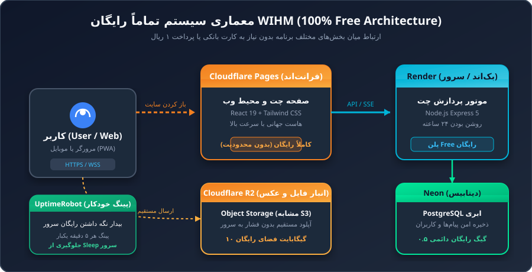
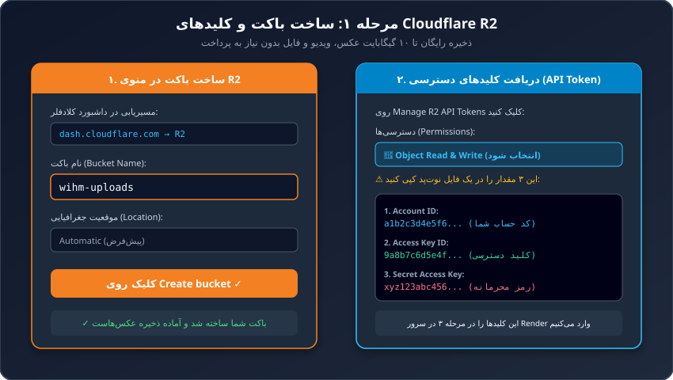
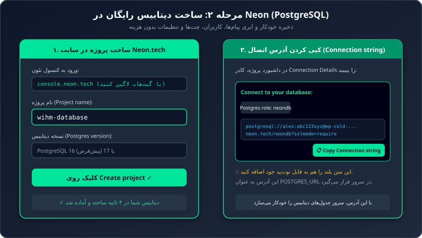
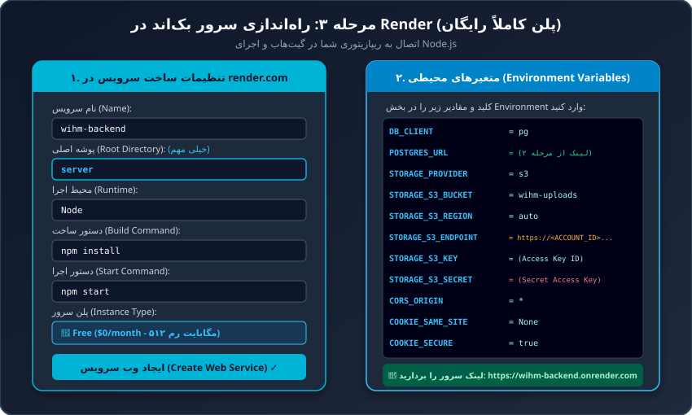
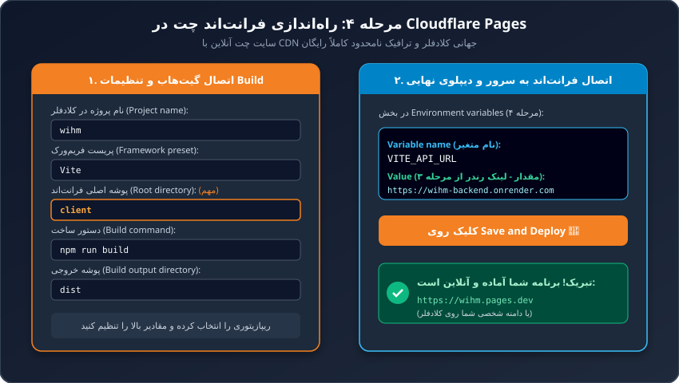
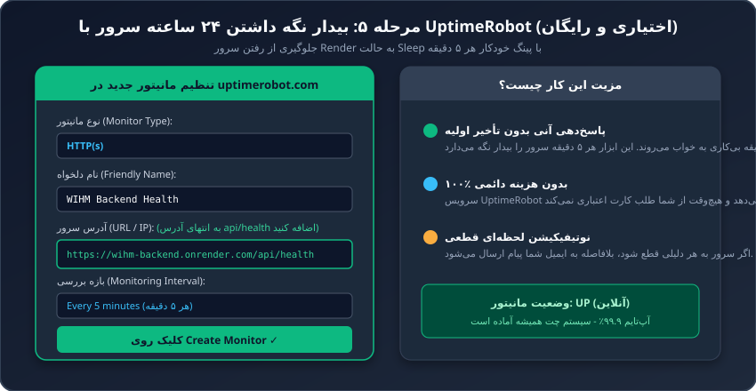

# Visual Step-by-Step Guide: Deploying WIHM on Cloudflare (100% Free Forever)

> 💡 **This tutorial is designed so that anyone, even with zero technical knowledge, can deploy their own real-time messenger platform completely free of charge ($0 forever).**

---

## 🧭 Architecture at a Glance

Deploying WIHM is like assembling ready-made building blocks:
1. **Cloudflare R2**: Free object storage for files, voice notes, and photos (10 GB free, $0 egress fees).
2. **Neon PostgreSQL**: Free serverless SQL database for messages and user accounts.
3. **Render**: Free backend Web Service running the Node.js API and real-time event gateway.
4. **Cloudflare Pages**: Free global hosting for the React web app UI with unlimited bandwidth and free SSL.

---

## 🛠️ Step 1: Create Object Storage (Cloudflare R2)

1. Sign in to your [Cloudflare Dashboard](https://dash.cloudflare.com).
2. In the left navigation, click on **R2** (or **Storage > R2**).
3. Click the blue **Create bucket** button.
4. Name your bucket (e.g., `wihm-uploads`) and click **Create bucket**.
5. Click **Manage R2 API Tokens** (top right) and then **Create API Token**.
6. Under Permissions, select **Object Read & Write**.
7. Scroll down and click **Create API Token**.
8. **Important:** Copy and save these three values to a text file:
   - **Access Key ID**
   - **Secret Access Key**
   - **Account ID** (found in your browser URL or on the main R2 page)

---

## 🗄️ Step 2: Create Free Database (Neon PostgreSQL)

1. Go to **[neon.tech](https://neon.tech)** and sign in with GitHub.
2. Click **Create Project**, name it `wihm-db`, and click **Create project**.
3. Copy the **Connection String** (starts with `postgres://...`). Save this in your text file.

---

## 🖥️ Step 3: Deploy Backend Server (Render)

1. Go to **[render.com](https://render.com)** and sign in with GitHub.
2. Click **+ New** > **Web Service**.
3. Connect your repository: **DarkPoesidon/WIHM**.
4. Configure the service:
   - **Name:** `wihm-api`
   - **Root Directory:** `server`
   - **Runtime:** `Node`
   - **Build Command:** `npm install`
   - **Start Command:** `npm start`
   - **Plan:** `Free`
5. Under **Environment Variables**, add:

| Key | Value |
|---|---|
| `APP_ENV` | `production` |
| `DB_CLIENT` | `pg` |
| `POSTGRES_URL` | *(Paste connection string from Step 2)* |
| `STORAGE_PROVIDER` | `s3` |
| `STORAGE_S3_BUCKET` | `wihm-uploads` |
| `STORAGE_S3_REGION` | `auto` |
| `STORAGE_S3_ENDPOINT` | `https://<ACCOUNT_ID>.r2.cloudflarestorage.com` |
| `STORAGE_S3_KEY` | *(Access Key ID from Step 1)* |
| `STORAGE_S3_SECRET` | *(Secret Access Key from Step 1)* |
| `CORS_ORIGIN` | `*` |
| `COOKIE_SAME_SITE` | `None` |
| `COOKIE_SECURE` | `true` |

6. Click **Deploy Web Service** and wait ~2 minutes until status turns green (**Live**).
7. Copy your backend service URL (e.g., `https://wihm-api.onrender.com`).

---

## 🌐 Step 4: Deploy Web UI (Cloudflare Pages)

1. In Cloudflare Dashboard, go to **Workers & Pages** > **Create application** > **Pages**.
2. Click **Connect to Git**, authorize GitHub, and select **DarkPoesidon/WIHM**.
3. Set build configuration:
   - **Framework preset:** `Vite`
   - **Root directory:** `client`
   - **Build command:** `npm run build`
   - **Build output directory:** `dist`
4. Under **Environment variables**, add:
   - **Variable name:** `VITE_API_URL`
   - **Value:** Your Render backend URL from Step 3 (e.g. `https://wihm-api.onrender.com`)
5. Click **Save and Deploy**.
6. When done, your chat application will be accessible at `https://wihm.pages.dev`!

---

## 💡 Keep Server Awake (UptimeRobot - Optional)

1. Go to **[uptimerobot.com](https://uptimerobot.com)** (100% free account).
2. Create an **HTTP(s)** monitor for your health endpoint:  
   `https://wihm-api.onrender.com/api/health`
3. Set interval to **Every 5 minutes**.
4. This keeps the free Render instance awake 24/7 with zero cold starts!
